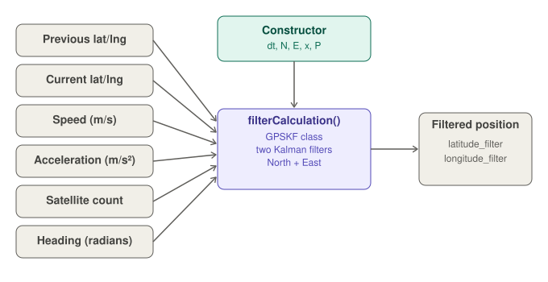
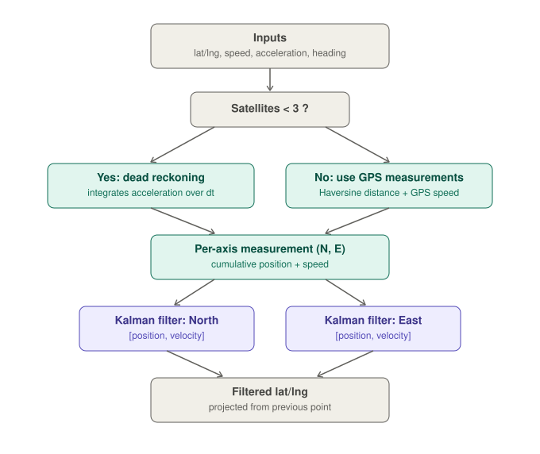
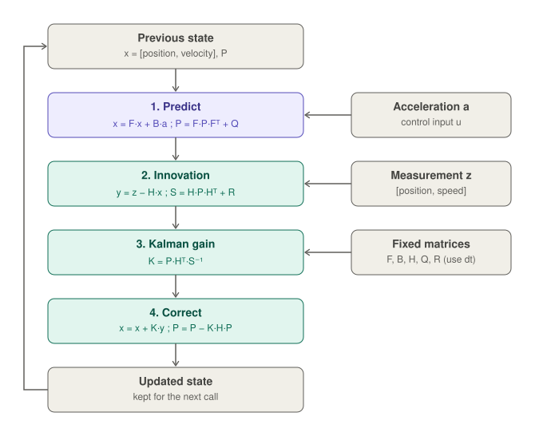
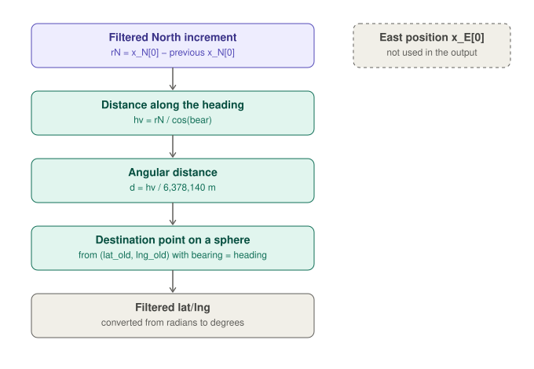

# GPSKalmanFilter

An Arduino-compatible C++ library that smooths GPS positions with a **Kalman filter** and uses an accelerometer reading and a heading angle to keep estimating the position when the GPS signal is poor.

It was written by Gabriel Lopes (March 2022) for a vehicle-tracking capstone project and runs on microcontrollers such as the ESP32. The implementation is intentionally plain C++ (fixed 2×2 matrices written with loops, no linear-algebra dependency), so it is small and easy to read.

---

## Table of contents

- [Features](#features)
- [How it works](#how-it-works)
- [API reference](#api-reference)
- [Usage example](#usage-example)
- [Units and conventions](#units-and-conventions)
- [Filter parameters](#filter-parameters)
- [Installation](#installation)
- [Known issues and limitations](#known-issues-and-limitations)
- [Credits](#credits)

---

## Features

- Two independent Kalman filters, one for the **North** axis and one for the **East** axis.
- Each filter tracks a 2-state vector `[position, velocity]` and uses acceleration as a control input.
- **Dead-reckoning fallback:** with fewer than 3 satellites, the position is estimated from the acceleration instead of the GPS.
- Returns the filtered **latitude and longitude** directly.
- No dynamic memory and no external math library, only `<math.h>` and the `Haversine` helper.

---

## How it works

You create one `GPSKF` object with the filter's initial state, then call `filterCalculation()` every `dt` seconds with the latest GPS fix and sensor values. The function returns the filtered coordinates through two reference parameters.



### Decision flow

Inside `filterCalculation()`, the heading is used to split everything into North and East components (`cos(heading)` for North, `sin(heading)` for East). The number of satellites decides where the measurement comes from:



| Condition | Position measurement | Speed measurement |
| --- | --- | --- |
| `nSatelite < 3` (poor GPS) | Dead reckoning: integrates the acceleration over `dt` | Previous speed + acceleration × `dt` |
| `nSatelite >= 3` | Haversine distance between the previous and current fix, times `cos`/`sin` of the heading | GPS speed times `cos`/`sin` of the heading |

The measured displacements are **added to running totals** `N` and `E`. These cumulative positions, together with the speed, form the measurement vector `z` for each filter.

### Kalman cycle (per axis)

Both axes run the standard predict and update steps, using the axis acceleration as the control input `u`:



| Step | Equation |
| --- | --- |
| Predict state | `x = F·x + B·a` |
| Predict covariance | `P = F·P·Fᵀ + Q` |
| Residual | `y = z − H·x` |
| Innovation covariance | `S = H·P·Hᵀ + R` |
| Kalman gain | `K = P·Hᵀ·S⁻¹` (2×2 inverse computed with the determinant) |
| Update state | `x = x + K·y` |
| Update covariance | `P = P − K·H·P` |

### From filtered position to latitude/longitude

The filtered North position `x_N[0]` is compared with its value from the previous call to get an increment `rN`. That increment is turned into a distance along the heading and projected onto the globe, starting from the **previous GPS point** (`lat_old`, `lng_old`):



The projection is the spherical destination-point formula:

```text
lat2 = asin( sin(lat1)·cos(d) + cos(lat1)·sin(d)·cos(bearing) )
lon2 = lon1 + atan2( sin(bearing)·sin(d)·cos(lat1), cos(d) − sin(lat1)·sin(lat2) )
```

with `d = hv / 6,378,140` (distance divided by the Earth radius in meters).

---

## API reference

### Constructor

```cpp
GPSKF(double dt, double N, double E,
      double x_N[2][1], double P_N[2][2],
      double x_E[2][1], double P_E[2][2]);
```

| Parameter | Meaning |
| --- | --- |
| `dt` | Time step in seconds. **Must match the real period at which you call the filter.** |
| `N`, `E` | Initial cumulative North and East positions (normally `0`). |
| `x_N`, `x_E` | Initial state vectors `[position; velocity]` for each axis. |
| `P_N`, `P_E` | Initial 2×2 covariance matrices for each axis. |

### `filterCalculation`

```cpp
void filterCalculation(double lat_old, double lng_old,
                       double lat_cur, double lng_cur,
                       double velocity, double acceleration,
                       uint8_t nSatelite, double angle,
                       double &latitude_filter, double &longitude_filter);
```

| Parameter | Meaning |
| --- | --- |
| `lat_old`, `lng_old` | Previous GPS position, in degrees. |
| `lat_cur`, `lng_cur` | Current GPS position, in degrees. |
| `velocity` | Speed reported by the GPS. |
| `acceleration` | Linear acceleration along the direction of travel. |
| `nSatelite` | Number of satellites in use. Below 3, dead reckoning is used. |
| `angle` | Heading in **radians**, measured clockwise from North. |
| `latitude_filter`, `longitude_filter` | Output: filtered position in degrees (passed by reference). |

---

## Usage example

```cpp
#include <GPSKalmanFilter.h>

// Initial state and covariance for each axis
double x_N[2][1] = {{0}, {0}};
double x_E[2][1] = {{0}, {0}};
double P_N[2][2] = {{5, 0}, {0, 1}};
double P_E[2][2] = {{5, 0}, {0, 1}};

const double DT = 0.20;                       // seconds, must match the loop period
GPSKF gpsKalmanFilter(DT, 0, 0, x_N, P_N, x_E, P_E);

double latPrev, lngPrev;                      // previous GPS fix

void loop() {
  // ... read your GPS, accelerometer and compass every DT seconds ...
  double latFiltered, lngFiltered;

  gpsKalmanFilter.filterCalculation(
      latPrev, lngPrev,                       // previous fix (degrees)
      latCur, lngCur,                         // current fix (degrees)
      speed,                                  // GPS speed
      linearAccel,                            // acceleration along travel direction
      satellites,                             // number of satellites
      headingRadians,                         // heading in radians
      latFiltered, lngFiltered);              // outputs

  latPrev = latCur;
  lngPrev = lngCur;
}
```

A complete use of the library, including sensor fusion and LoRaWAN transmission, is available in the **GPS Tracking System** project.

---

## Units and conventions

The code does not enforce units, but the formulas assume:

| Quantity | Unit |
| --- | --- |
| Distances (`haver`, `N`, `E`) | meters (consistent with the 6,378,140 m Earth radius) |
| Speed | meters per second |
| Acceleration | meters per second squared |
| Heading `angle` | radians, 0 = North, increasing clockwise (`cos` = North, `sin` = East) |
| Latitude / longitude | decimal degrees |
| `dt` | seconds |

---

## Filter parameters

The noise and model matrices are defined **inside** `filterCalculation()`. To tune the filter, edit them in `GPSKalmanFilter.cpp`:

| Matrix | Current value | Effect |
| --- | --- | --- |
| `F` | `[[1, dt], [0, 1]]` | Constant-velocity transition. |
| `B` | `[dt²/2, dt]` | How acceleration changes position and speed. |
| `H` | identity (2×2) | Both position and speed are measured. |
| `R` | `diag(6.25, 5)` | Measurement noise. Larger values trust the GPS less. |
| `Q` | based on `Q_var = 0.1` and powers of `dt` | Process noise. Larger values trust the model less. |

---

## Installation

The library depends on a `Haversine` helper (`Haversine.h`) that provides `dtor`, `rtod`, `calcDistance` and `calcBearing`. It is not included in this repository, so install it first (it is part of the GPS Tracking System project).

1. Copy the `GPSKalmanFilter` folder into your Arduino `libraries/` directory, keeping the `src/` subfolder.
2. Install the `Haversine` library the same way.
3. If the Arduino IDE does not detect the library, add a `library.properties` file next to `src/`:

   ```ini
   name=GPSKalmanFilter
   version=1.0.0
   author=Gabriel Lopes
   maintainer=Gabriel Lopes
   sentence=Kalman filter for GPS positions with dead-reckoning fallback.
   paragraph=Fuses GPS, acceleration and heading to filter latitude and longitude.
   category=Signal Input/Output
   url=https://github.com/<your-user>/GPSKalmanFilter
   architectures=*
   ```

4. Include it in your sketch with `#include <GPSKalmanFilter.h>`.

---

## Known issues and limitations

- **No singularity check.** The inverse of `S` divides by its determinant without checking for zero.
- **Hard-coded parameters.** `R`, `Q_var`, `F`, `B` and `H` are redefined at every call and cannot be changed without editing the source.
- **Heading is an input, not computed.** The bearing computed from the GPS points (`Haversine().calcBearing`) is commented out; the caller must provide a good heading. A noisy compass directly degrades the result.
- **Documentation mismatch.** An earlier version of the README mentions a `begin` function. The current code uses the constructor described above.
- **Code style.** The author notes that the library does not follow best practices: long function, repeated blocks for North and East, and leftover commented debug code.

---

## Credits

- **Author:** Gabriel Lopes (created March 24, 2022).
- **Haversine helper:** based on code by Matheau Goonan, modified for this project.

